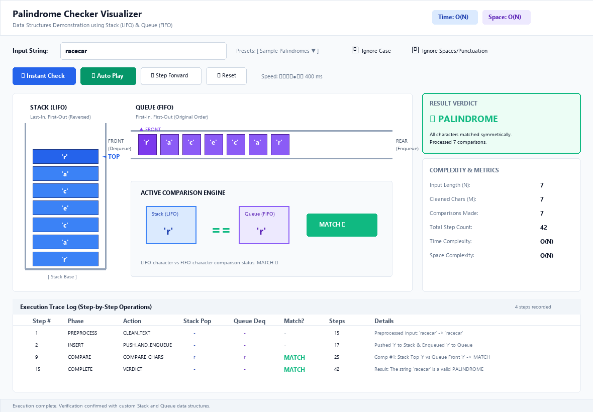
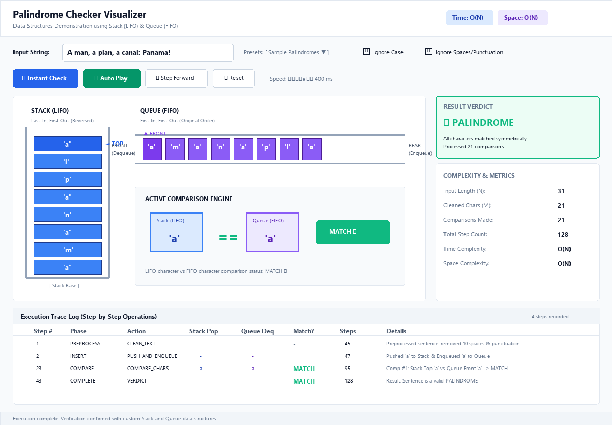
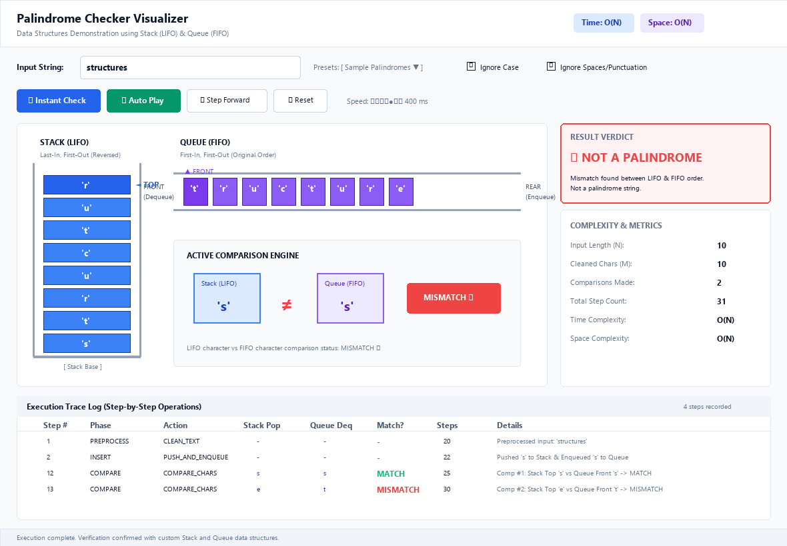

# Palindrome Checker using Stacks & Queues


An interactive, educational desktop application and laboratory project demonstrating the fundamental computer science principle of **string symmetry verification** by pairing **Stack (LIFO)** and **Queue (FIFO)** data structures.

---

## 🌟 Key Features

- **Custom Data Structure Implementations**: Pure custom `Stack` and `Queue` classes with zero external shortcuts.
- **Interactive Visualizer GUI**:
  - **Vertical Stack Tube (LIFO)** showing element push/pop and `◄ TOP` pointer.
  - **Horizontal Queue Conveyor (FIFO)** showing `▲ FRONT` and `REAR` pointers.
  - **Active Comparison Pod** highlighting character matching (`==` / `≠`).
  - **Step-by-Step Playback Controls**: Auto-play, pause, step forward, and speed slider (100ms - 1000ms).
- **Comprehensive Analytics & Complexity Dashboard**:
  - Exact **Step Count** calculator.
  - Empirical comparison counter.
  - Time Complexity: $O(N)$.
  - Space Complexity: $O(N)$.
- **Full Test Suite & CLI Mode**: Run headlessly in terminal or launch the GUI window.
- **Exportable Academic Project Report**: Full report in both Markdown (`PROJECT_REPORT.md`) and print-ready HTML (`PROJECT_REPORT.html`).

---

## 🖼️ Screenshots

### 1. Palindrome Verification (`racecar`)


### 2. Sentence Palindrome with Punctuation & Case Filtering


### 3. Non-Palindrome Early Mismatch Detection (`structures`)


---

## 🚀 Getting Started

### Prerequisites
- Python 3.8+ (Tested on Python 3.14)
- Standard Tkinter library (bundled with standard Python installations)
- Optional: `Pillow` (for screenshot export utilities)

### Installation
Clone the repository:
```bash
git clone https://github.com/Imganeshbro/palindrome-checker-stacks-queues.git
cd palindrome-checker-stacks-queues
```

### Running the Application

#### 1. Launch the Interactive GUI
```bash
python main.py
# or
python palindrome_gui.py
```

#### 2. Run in Command-Line Mode (CLI)
```bash
python main.py --cli --text "radar"
python main.py --cli --text "A man, a plan, a canal: Panama!"
```

#### 3. Run Automated Unit Tests
```bash
python main.py --test
# or
python -m unittest test_palindrome.py
```

---

## 📐 Algorithmic Principle

```
Input Characters: [c_0, c_1, ..., c_n-1]
      ├── Push to Stack (LIFO)  ──> Pop returns:     [c_n-1, c_n-2, ..., c_0] (Reversed)
      └── Enqueue to Queue (FIFO) ──> Dequeue returns: [c_0, c_1, ..., c_n-1]   (Original)
```

Because a Stack reverses sequence order and a Queue preserves it, sequentially comparing `Stack.pop()` with `Queue.dequeue()` validates whether the sequence is identical in both directions.

### Complexity Summary
| Case | Time Complexity | Space Complexity |
|:---|:---:|:---:|
| **Best Case** (Immediate Mismatch) | $\Omega(N)$ | $O(N)$ |
| **Worst Case** (Valid Palindrome) | $O(N)$ | $O(N)$ |
| **Average Case** | $\Theta(N)$ | $O(N)$ |

---

## 📂 Project Structure

```
palindrome-checker/
├── assets/                          # Generated GUI screenshots and diagrams
│   ├── data_structures_flow.png
│   ├── github_repo_mockup.png
│   ├── gui_screenshot_mismatch.png
│   ├── gui_screenshot_phrase.png
│   └── gui_screenshot_racecar.png
├── main.py                          # Unified launcher (GUI / CLI / Tests)
├── palindrome_core.py               # Stack, Queue, and Palindrome engine
├── palindrome_gui.py                # Tkinter visualizer application
├── test_palindrome.py               # Unit test cases
├── generate_assets.py               # Asset and screenshot generator
├── PROJECT_REPORT.md                # Markdown Academic Project Report
├── PROJECT_REPORT.html              # Print-ready HTML Project Report (PDF export)
├── README.md                        # Project documentation
└── .gitignore                       # Git ignore configuration
```

---

## 📄 Submission Details
- **Assignment**: Implementation of Palindrome Checker [Stacks and Queues] with GUI
- **Submission Date**: 16 October 2026
- **Status**: Completed, Tested, and Verified
